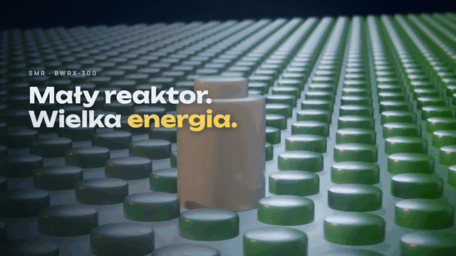
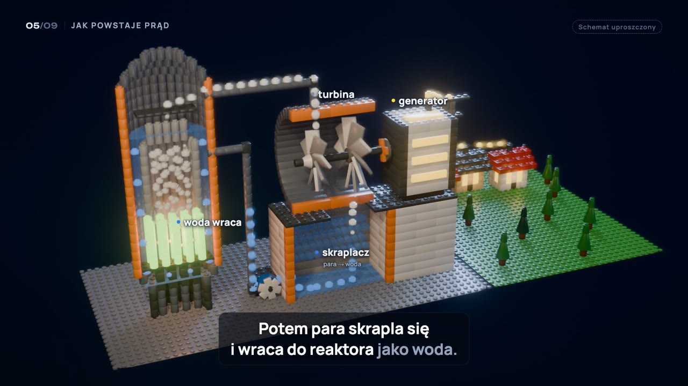

# Reaktor z klocków — jak działa mały reaktor modułowy (SMR)

Edukacyjna animacja (2:28, po polsku) o reaktorze **BWRX-300**, który w Polsce chce budować firma
Michała Sołowowa (SGE, częściowo wspólnie z Orlenem w spółce OSGE). Cały film to diorama
z klocków: od rozszczepienia uranu, przez wrzącą wodę i turbinę, po pasywne bezpieczeństwo.

<p align="center"></p>

<p align="center">
  <a href="https://github.com/agentsmill/reaktor-z-klockow/releases/latest"></a><br>
  <b>▶ <a href="https://github.com/agentsmill/reaktor-z-klockow/releases/latest">Obejrzyj cały film</a></b> —
  <a href="https://github.com/agentsmill/reaktor-z-klockow/releases/download/v1.0/smr-reaktor-z-klockow.mp4">1080p</a> ·
  <a href="https://github.com/agentsmill/reaktor-z-klockow/releases/download/v1.0/smr-reaktor-z-klockow-720p.mp4">720p</a>
</p>

> Schematy są uproszczone. Klocki są generyczne (to nie jest produkt żadnej marki).
> Głos i muzyka: AI (ElevenLabs przez fal.ai). Źródła faktów — na końcu filmu i niżej.

---

## SMR explainer (PL) — how the BWRX-300 works

**v2: "Reaktor z klocków"** — every scene is a 3D toy-brick diorama rendered in Blender 5.2 (EEVEE),
composited in Remotion with the narration, captions, labels and music. Scenes without a finished
render fall back to the original 2D version automatically.

~2:28 educational animation (1920×1080, Polish voiceover + captions) about the small modular
reactor that Michał Sołowow's SGE (with Orlen, as OSGE) plans to build in Poland.
Built with Remotion; voice, music, sound effects and two stills generated with fal.ai.

Output: `out/smr-reaktor-z-klockow.mp4` (3D bricks, 1080p master) + `-720p.mp4` copy; v1 2D: `out/smr-bwrx300.mp4`

## How it fits together

- `src/script.ts` — **all narration** (Polish) + the cue words that trigger animations.
  `show` = captions, `say` = what the TTS reads (phonetic spelling for SMR / BWRX-300).
- `scripts/voiceover.ts` — ElevenLabs TTS via fal.ai with word timestamps → `public/audio/vo/`
  and `src/generated/voiceover.json`. Scene lengths and every cue are computed from it, so
  visuals re-sync automatically when you change a sentence.
- `src/scenes/*` — one file per scene; `src/components/*` — reactor, turbine, atoms, map…
- `src/lib/*` — tested logic: timeline, cues, captions (Polish line-break rules), cascade.

## Common edits

```bash
npm run studio                       # preview in Remotion Studio
npm test                             # unit tests (timing, captions, cues, script)
```

Change narration → edit `src/script.ts`, then:

```bash
npm run assets:voice -- --force      # regenerate voiceover (~$0.20)
scripts/normalize-vo.sh              # loudness to -16 LUFS
npm run render                       # → out/smr-bwrx300.mp4
```

Change the narrator: set `VOICE` in `scripts/voiceover.ts` (Brian, George, Daniel, Eric, Roger…),
regenerate as above. Auditions of 6 voices: `out/audition/`.

Requires `FAL_KEY` in `.env` (git-ignored).

## Sources (end card)

GE Vernova Hitachi — BWRX-300 General Description (Rev. J, 06/2026) · OSGE · World Nuclear
Association · IPCC AR5 WGIII Annex III · energetyka24.com, XYZ, Rzeczpospolita, PAP/Bankier (30.09–01.10.2026).
Diagrams are simplified; AI stills are labelled "Wizualizacja AI".

## 3D pipeline (Blender)

```bash
npx tsx scripts/export-timeline.ts                                   # scene lengths + cue frames → blender/timeline.json
/Applications/Blender.app/Contents/MacOS/Blender -b -P blender/render.py -- --shot intro --preview --frames 1,60,120
/Applications/Blender.app/Contents/MacOS/Blender -b -P blender/render.py -- --shot intro   # full JPEG sequence + anchors
npx tsx scripts/collect-renders.ts                                   # tell Remotion which shots are complete
npm run render
```

- `blender/lib/` — brick library (`bricks`), look (`look`: plastic, light, camera), motion (`anim`, `camera`),
  shape builders (`build`), the riverside diorama (`diorama`), the BWRX-300 cutaway (`vessel`), label anchors.
- `blender/shots/<scene>.py` — one script per scene; events are keyed to narration cue frames.
- Label anchors: shots register 3D points; their screen positions per frame go to
  `public/renders/<scene>/anchors.json`, and Remotion labels follow them (`useAnchor`).

### Watch it live in Blender (Blender Lab MCP)

The official Blender MCP add-on is installed (Preferences → Add-ons → MCP; needs *Allow Online Access*).
`python3 blender/live.py shot intro` builds a shot in a new scene of the running Blender and plays it.
The `blender` MCP server is registered for this folder in Claude Code (available in new sessions).
